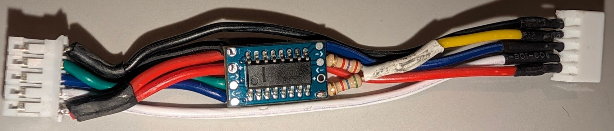
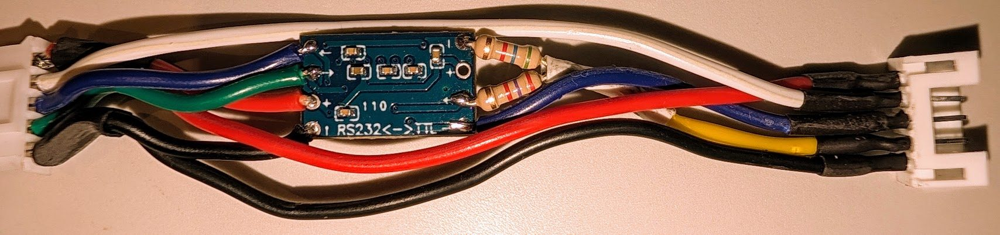
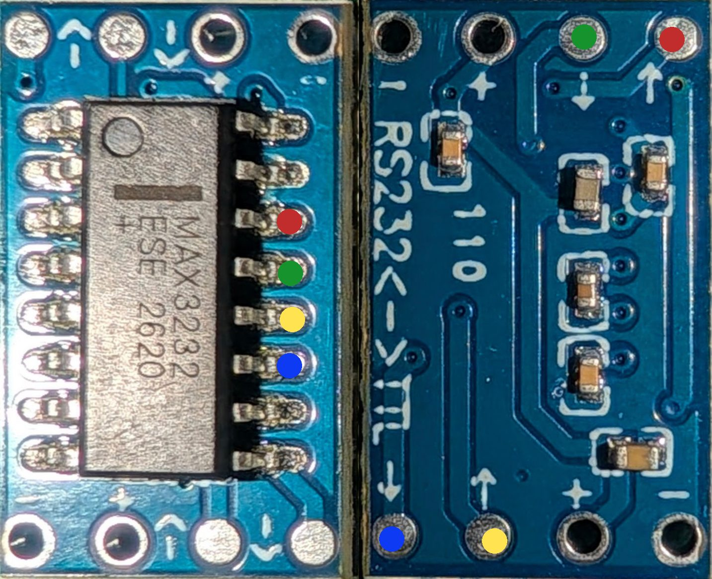

# Inline MAX3232 adapter: the V23 on the mainboard leveling port

One of two supported ways to wire the V23 up — the other, a CH341 USB-UART, is `INSTALL.md`
section 3. A small adapter plugs into the K1 mainboard's leveling
connector and takes the stock harness to the V23. It converts the mainboard's **RS-232** levels to
the board's **3.3 V TTL**, so the V23 runs on `/dev/ttyS9`, the port Creality intended, and no USB
device is needed.

**Status (2026-11-10): fully proven, including a real print.** `prtouch_v3.cfg` is switched to
`/dev/ttyS9`. The build had one wiring fault (section 7, V23 TX/RX swapped at the harness socket,
fixed) and one false alarm that turned out to be the bed, not the adapter (section 8: a mechanical
anomaly after reassembly, resolved by remounting the board and then fully re-leveling the bed —
`systems/k1m.md` Change Log 2026-11-10 "Bed re-leveled..."). After that: `PRTOUCH_PROBE_ACCURACY`
gave a 1.68 µm range (10 samples, the tightest ever recorded on this board) and a second run
5.06 µm; `_LOAD_CELL_HOME_Z` contact at z=0.1341, 248 counts/µm, homed successfully; and a real
print came out looking good. This adapter is an **alternative** wiring method, not a replacement
for the CH341 (section 6 step 5 is optional, not a cleanup step) — see `INSTALL.md` for why you
might pick one over the other. **A second build (2026-11-11, section 4's 2k7/5k6 divider note)
checked out the same way**, no bench iteration on the divider needed this time.




## 1. Why

- On the x2000 mainboard (`CR4CU220812S11`), the leveling port is RS-232: TX idles at **−5.5 V**
  and RX is a receiver input pulled to GND. The old V11 board had its own MAX3232 (U3 `3232E`); the
  V23 talks plain 3.3 V TTL and has none. Wired directly, the board's frames arrive scrambled, it
  answers nothing, and its RX gets pulled to −2.2 V, outside the CH32V203's rating. Details:
  `systems/k1m_v23_leveling.md`, "Why the mainboard port (ttyS9) fails".
- The CH341 works, but it's a USB device on the internal hub `1-1.2`, shared with the chamber
  heater's RP2040 (micro4). Replugging the CH341 there took micro4 down. The adapter frees the USB
  port and uses the serial port the mainboard already has.

## 2. Parts

| Part | Notes |
|---|---|
| MAX3232 breakout ("RS232<->TTL", 2× 4-pin rows, 6 SMD capacitors) | the common blue mini module. The chip on k1m's is marked `MAX3232 ESE 2620` and behaves like a clone (weak TTL output, section 4) |
| 5-pin male plug for the mainboard + 5-pin female socket for the stock harness | the leveling connector, `GND TX RX SYNC 5V` |
| Resistors **2k7** and **5k6** | the divider on the TTL output — see section 4 for why these values and not the textbook 1k/2k |
| Wire, heat shrink | |

Pick divider resistors by the same rule as these two: go for the **largest** pair you reasonably
have that keeps roughly a 2:1 ratio, rather than the smallest. A higher-resistance divider draws
less current, which makes the result far less sensitive to the module's own TTL output impedance
— an unknown that varies module to module and caused the first adapter's smaller, textbook-sized
divider to undershoot (section 4).

## 3. Module pinout (traced)

The capacitors are the MAX3232's charge pump (C1/C2 pump, C3/C4 hold V+/V−, plus VCC bypass).
Nothing needs adding to the module. Traced with a meter. With the chip text upright and the dot
top-left, pins 9-16 run up the right side:



| Photo dot | Chip pin | Signal | Header row (back says `RS232<->TTL`) | Arrow on the silkscreen |
|---|---|---|---|---|
| red | 14 | **T1OUT**, RS-232 out | RS-232 row, corner pin | ↑ |
| green | 13 | **R1IN**, RS-232 in | RS-232 row | ↓ |
| yellow | 12 | **R1OUT**, TTL out | TTL row | ↑ |
| blue | 11 | **T1IN**, TTL in | TTL row, corner pin | ↓ |
| | 16 / 15 | VCC / GND | `+` / `−` on **both** rows (same nets) | |

The arrows are from the module's point of view: **↓ = into the module, ↑ = out of it.**

## 4. Circuit

```
 male plug (into the mainboard)                        female socket (stock harness to the V23)

   5V   ─────────────────┬───────────────────────────────────  5V
                         └── module +
   GND  ─────────────────┬───────────────────────────────────  GND
                         └── module −
   SYNC ─────────────────────────────────────────────────────  SYNC   (bypasses the module)

   TX (−5.5 V idle) ──── R1IN  (pin 13, RS-232 row)
   RX               ──── T1OUT (pin 14, RS-232 row)
                                         T1IN  (pin 11, TTL row) ──── V23 TX wire
                                         R1OUT (pin 12, TTL row)
                                              │
                                            [2k7]
                                              │
                                              ●──────────────────────  V23 RX wire   (target 3.0-3.4 V)
                                              │
                                            [5k6]
                                              │
                                         module − (GND)
```

- Only TX and RX go through the module. 5V, GND and SYNC are plain wires from plug to socket;
  5V and GND also feed the module's `+`/`−`. The mainboard's TX and RX must **not** also run
  through to the socket.
- **Which harness wire is V23 TX vs RX:** pin positions don't match labels end to end (on k1m
  the board's RX landed on the mainboard's TX pin). Identify them by continuity to the pins
  labelled **TX** and **RX** on the V23's own connector.
- **Why the divider:** the module runs on the connector's 5 V (the MAX3232 is rated 3.0-5.5 V), so
  R1OUT swings to 5 V, but the V23's CH32V203 is a 3.3 V part. The board's 3.3 V TX into T1IN is
  fine (threshold ≤ 2.4 V at 5 V supply).
- **Why 2k7 / 5k6, and not the textbook 1k / 2k:** pick the *largest* resistor pair you reasonably
  have, keeping roughly that same ~2:1 ratio, rather than the smallest — a higher-resistance
  divider draws less current, which makes the result far less sensitive to the module's own TTL
  output impedance. That impedance is an unknown that varies module to module, and on the first
  adapter's module (section 5) it turned out weak enough (~680 Ω effective series resistance) that
  a 1k/2k divider only reached 2.66 V instead of the expected ~3.3 V. At ~8.3 kΩ total, 2k7/5k6
  stays in the 3.0-3.4 V target (CH32V203 reads "high" from ~2 V; max 3.6 V) across the whole range
  from an ideal output (3.37 V predicted) to one as weak as the first module's (3.11 V predicted) —
  worked first try on the second build (2026-11-11), with no bench iteration needed, and checked
  out electrically and mechanically identical to the first adapter (`PRTOUCH_PROBE_ACCURACY`
  3.58 µm range, `_LOAD_CELL_HOME_Z` 330 counts/µm). Section 9 has how far this reasoning can be
  pushed — not very far; it has its own ceiling.
- **First build, for reference:** with that weak module, 1k2 over 2k2+1k5 in series (3k7) measured
  **3.28 V** on the bench (section 5): `4.92 × 3.7 / (0.68 + 1.2 + 3.7) ≈ 3.26 V` predicted, found
  by measuring and adjusting rather than sized upfront. A 3.3 V regulator (HT7333, AMS1117-3.3)
  feeding the module instead of 5 V removes the divider question entirely, for either build.

## 5. Bench measurements (first build's module, on 5.00 V, nothing else connected)

The pin mapping and the charge-pump health check (T1OUT negative, R1IN ~0 V) should hold for any
module of this type. The exact millivolt readings — especially R1OUT's — are this specific
module's; the second build's module wasn't bench-tested pin-by-pin in isolation (it went straight
to the in-system checks in section 6), since 2k7/5k6 was sized to tolerate that variation rather
than chasing an exact number.

| Pin | Reading | Means |
|---|---|---|
| 16 VCC | 4.99 V | |
| 15 GND | 0.001 V | |
| 14 T1OUT | **−8.97 V** | driver idling at RS-232 mark. The charge pump makes ~±10 V from 5 V; −9 V unloaded is normal (spec ±5…±15 V). Expect −7…−8 V once loaded by the mainboard's receiver |
| 13 R1IN | 0.003 V | receiver input, internal ~5 kΩ pulldown |
| 12 R1OUT | 4.92 V unloaded / 4.10 V with the divider | TTL high (idle) |
| 11 T1IN | 3.98 V | internal pull-up, unconnected |
| 10 / 9 | 0.30 V / 4.58 V | unused second channel (T2IN floating, R2OUT idle high) |
| divider node | **3.282 V** | goes to the V23's RX |

## 6. Bring-up in the printer

1. **Adapter alone:** printer off, plug the adapter into the mainboard, harness **disconnected**.
   Power on. Expect on the socket side: V23-RX pin in your divider's target range (3.0-3.4 V,
   section 4); 5V ≈ 5 V; SYNC ≈ 3.3 V. Optionally, the mainboard RX line (from T1OUT) ≈ −7…−9 V.
2. **Add the V23:** printer off, harness into the adapter, power on. **Done 2026-11-06.** First
   attempt was silent on `/dev/ttyS9` in both directions; traced to the V23's TX/RX swapped at the
   harness socket (section 7), fixed by swapping those two wires.
3. **Talk to it.** `[prtouch_v3]` was still pointed at the CH341 at this point, so `/dev/ttyS9` was
   unclaimed; Klipper did not need stopping. (If `prtouch_v3.cfg` already has `serial:
   /dev/ttyS9`, stop the service first so the port is free: `/etc/init.d/S55klipper_service
   stop`.)
   ```sh
   /usr/share/klippy-env/bin/python3 /usr/data/k1m-v23-leveling.py listen /dev/ttyS9 -t 12 --decode
   /usr/share/klippy-env/bin/python3 /usr/data/k1m-v23-leveling.py status /dev/ttyS9
   /usr/share/klippy-env/bin/python3 /usr/data/k1m-v23-leveling.py loadcells /dev/ttyS9 -t 5
   ```
   **Done 2026-11-10, after the TX/RX fix, with the printer idle (no motion commanded):**
   - `listen`: two idle `stats` frames in 12 s, on the expected ~5 s cadence, decoded cleanly.
   - `status`: `version CTF_V1.0.0.16.20250320`, `MCU ch32v203x8`, 73 commands / 28 responses —
     an exact match to the CH341 identify.
   - `loadcells -t 5`: all 4 channels streaming at full rate (~620/channel over 5 s), idle offsets
     and noise matching the board's known values (e.g. ch0 ≈ 397000 ±2000, ch3 ≈ −356600 ±2300),
     clean `start`/`stop` acks.
   - **If it fails:** scrambled `79 37 …` frames mean the level conversion isn't in the path. Check
     that TX/RX don't also run straight through. Silence means TX/RX are swapped somewhere: check
     the continuity mapping from section 4, and see section 7 for how this adapter's first attempt
     was silent for exactly that reason.
   - Check whether Creality's `S13mcu_update` still probes ttyS9 at boot (it used to log `handshake
     /dev/ttyS9 success`). Its bytes would now reach the board. The board probably ignores them;
     disable the probe if it's still active.
4. **Switch Klipper over** in `prtouch_v3.cfg`, keeping the default 230400 baud:
   ```ini
   serial: /dev/ttyS9
   ```
   Full service restart, not `RESTART`/`FIRMWARE_RESTART` (`INSTALL.md` section 6 step 5):
   ```sh
   rm -f /usr/data/klipper/klippy/extras/prtouch_v3.pyc
   /etc/init.d/S55klipper_service restart
   ```
   **Done 2026-11-10** (printer upright, confirmed clear beforehand). Ready, no config warnings,
   `prtouch_v3` present.
   - `PRTOUCH_DIAGNOSTIC TIME=5` (no motion): tare and noise matched the bench `loadcells` run
     exactly (ch0 396852, ch1 −220750, ch2 −284616, ch3 −357319). **Electrical link confirmed
     good under the module's own code path, not just the bench tool.**
   - After `G28`, `PRTOUCH_PROBE_ACCURACY SAMPLES=5`: range 3.5 µm, stdev 1.3 µm — matches the
     CH341's repeatability (2.7-4.2 µm / 1.0-1.6 µm in prior runs). But the contact height itself
     came back as **≈0.98 mm**, not the 0.13-0.22 mm this board has always read (cold or hot). The
     fit's per-tap stiffness was a normal ~230 counts/µm, so the 5 taps agree with each other —
     the anomaly is in *where* contact is, not in how cleanly it's measured.
   - `_LOAD_CELL_HOME_Z` then **failed its own fit-quality check**: `unreliable contact fit
     (stiffness 83.7 counts/um, residual 0.0098mm, extrapolation 0.0205mm)` — residual over the
     0.005 mm limit. The module did what it's for: it raised before applying anything, and
     retracted to Z1.0 (confirmed via `toolhead.position` afterwards; `last_home_z_result` stayed
     `None`). No Z was homed on bad data. See section 8 for what this points to and what's still
     open — **it's not a wiring or serial-link problem.**
5. **Optional, your call:** nothing left needs the CH341 once `_LOAD_CELL_HOME_Z` works over
   `/dev/ttyS9`, so you can unplug it and free up that USB port if you'd like. Equally fine to
   leave the CH341 itself connected to USB and just unused — this doc doesn't treat removing it as
   part of finishing the install. On k1m it's being kept as an easy path back to the CH341 wiring
   if ever needed (see "Switching back" below).

**Switching back to the CH341:** set `serial:` back to
`/dev/serial/by-id/usb-1a86_USB_Serial-if00-port0` and rewire the board's TX/RX to the CH341
(printer off) as in `INSTALL.md` section 3. The V23 only has one TX/RX pair, so it's the adapter
or the CH341, not both, whichever you pick.

## 7. Fault found: V23 TX/RX swapped at the harness socket

The first bring-up attempt (section 6 step 2, 2026-11-06) was silent on `/dev/ttyS9` in both
directions — no idle `stats` frames, no reply to `status`. Diagnosed from the bench, printer
powered, adapter and harness connected, nothing stopped or restarted:

| Pin | Expected (idle) | Measured | Verdict |
|---|---|---|---|
| green (R1IN, from mainboard TX) | ≈ −5.5 V | −5.25 V | ✔ mainboard side wired correctly |
| red (T1OUT, to mainboard RX) | ≈ −7…−9 V | −8.16 V | ✔ loaded as expected |
| blue (T1IN, from V23 TX) | ≈ 3.3 V, driven by the board | 3.53 V | ✘ looked like the unconnected pull-up, not a driven line |
| divider node (to V23 RX) | ≈ 3.28 V, undriven | 3.51 V | ✘ higher than the divider alone can produce — something was driving it |

The node reading above what the divider can produce on its own, together with blue sitting near
its idle pull-up voltage, meant the V23's own TX was landing on the node (not on blue) and its RX
was landing on blue (not on the node) — TX and RX swapped at the harness socket. **Fix:** swap the
two data wires on the socket (V23-TX wire to blue, V23-RX wire to the divider node). No damage: the
V23's TX only had to drive the divider's few mA, and blue's internal pull-up is weak.

**Lesson for the next build:** pin position doesn't carry across the stock harness (true at the
mainboard end too, `INSTALL.md` section 3) — identify TX and RX by continuity to the V23's own
labelled connector, not by matching header position, and verify with the section 6 step 3
`listen`/`status` check before trusting the link.

## 8. Resolved: contact height/stiffness shifted after reassembly — fixed by remount + re-leveling

**Resolved 2026-11-10.** After a full bed re-level (`systems/k1m.md` Change Log 2026-11-10, "Bed
re-leveled..."), `PRTOUCH_PROBE_ACCURACY` gave a 1.68 µm range over 10 samples (the tightest ever
recorded on this board) and `_LOAD_CELL_HOME_Z` homed cleanly at z=0.1341, 248 counts/µm — both
squarely back in this board's normal range. The investigation below is kept as a record of the
diagnosis, since the same reasoning (floor-constrained screws, highest-floor corner as reference)
would apply again if this bed is ever fully bottomed out a second time.

Found while verifying the adapter in the printer (section 6 step 4), after the printer had been
tipped on its side to build and wire the adapter and set upright again.

**Plan (in progress):** mount the V23 board and the adapter more permanently — rather than the
temporary wiring used to get the adapter built and bench-verified — then re-run the section 6
step 4 checks (`PRTOUCH_DIAGNOSTIC`, `PRTOUCH_PROBE_ACCURACY`, `_LOAD_CELL_HOME_Z`) and compare
against the table below. If the numbers are back in range, update this section and the status
line and move on to section 6 step 5. If not, work through the checklist further down.

**Update, after the board and bed were remounted (no print sheet on yet, bed leveling not done):**
the two numbers that matter for *this* mechanism — fitted stiffness **230.3 counts/µm** and fit
residual **0.0016 mm** — are back in the historical range (250-335 counts/µm) and better than any
prior run respectively. **The remount looks to have fixed the original anomaly.**
`PRTOUCH_PROBE_ACCURACY` still rejected the tap, but for an unrelated, expected reason: the first
coarse step (0.05 mm from the Z1.0 approach) already overshot deep past `trigger_force`, so only
4 fine points were usable, and the fitted zero-force intercept came out *above* the approach
start height — the module correctly refuses to trust contact above where it started probing. That
points at the bed currently sitting closer to the nozzle, at the default `approach_z`, than it
did before — expected, since the bed/leveling screws were just handled and there's no sheet on
yet. **Not a fit-quality problem; pending bed leveling** (and the sheet going back on), not
further investigation here. Raw data: coarse `z=0.95 force=17836` (first and only coarse step,
already far over `trigger_force`); fine pass from the backed-off height,
`1.09(1972) 1.08(4107) 1.07(6391) 1.06(8255) 1.05(11162)`.

**What changed, against every prior reading on this board (`systems/k1m_v23_leveling.md`,
`INSTALL.md` section 7):**

| | Historical (CH341, cold or 148 °C) | 2026-11-10 (adapter, same `G28`→Z1.0 approach) |
|---|---|---|
| Contact height | 0.13-0.22 mm | `PRTOUCH_PROBE_ACCURACY`: **≈0.98 mm** (5-tap range 3.5 µm, so repeatable) |
| Fitted stiffness | 250-335 counts/µm | accuracy taps ≈230 counts/µm (normal); the `_LOAD_CELL_HOME_Z` tap right after: **83.7 counts/µm** |
| Fit residual | < 0.005 mm (limit) | 0.0098 mm — tripped `max_fit_error`, so the module refused to home |

The raw data is internally consistent within each run (tight tap-to-tap agreement, a believable
straight-line fit each time) — this is not noise, a dropped frame, or a timing artifact from the
new serial path. `PRTOUCH_DIAGNOSTIC` immediately before matched the bench numbers exactly. So the
adapter and the electrical link are not implicated; something about the physical setup is.

**Two things changed in one run, which also argues against a single simple cause:**
- The contact *height* jumped by ~0.8 mm but was the same (≈0.98 mm, tight repeat) across all 5
  accuracy taps.
- The *stiffness* then dropped by roughly 3x between the accuracy run (≈230 counts/µm, normal) and
  the very next tap in `_LOAD_CELL_HOME_Z` (83.7 counts/µm) — on the same nozzle, same bed spot,
  minutes apart.

**Plausible causes, not yet checked:**
- A bed-mounted load-cell spring or mounting screw loosened or re-seated while the printer was
  tipped over for the wiring work, changing how force reaches the cells (this would explain the
  stiffness drop more than the height jump on its own).
- The `G28` Z reference (Cartographer scan) shifted — e.g. if the gantry or bed moved slightly
  relative to the scan sensor while the printer was on its side. This would explain the height
  jump: the physical gap at commanded Z1.0 is now ~0.8 mm smaller than it used to be.
- Nozzle residue cushioning the press (noted as a known failure mode in `touch_gate.cfg`'s
  comments) — plausible for the softer stiffness, less so for a clean, repeatable 0.98 mm height
  across 5 taps.

**If the numbers are still off after the permanent mount**, work through these in order:
1. With the printer off or motors disabled, **visually/manually check the nozzle-to-bed gap at
   Z1.0 after a fresh `G28`** — last measured close enough that the Z1.0 approach found contact
   only ~0.02 mm below it.
2. Clean the nozzle, then repeat `PRTOUCH_DIAGNOSTIC` and `PRTOUCH_PROBE_ACCURACY` cold and hot;
   compare stiffness and contact height against the table above.
3. If the gap/reference genuinely shifted, Cartographer's scan calibration likely needs redoing
   before Z-referencing anything off it.

Do not loosen `min_stiffness`/`max_fit_error` in `prtouch_v3.cfg` to force a home through on this
data — the rejection is correct given how far these numbers are from this board's history.

## 9. If you build another one

- Measure the module first (section 5): T1OUT clearly negative, R1IN ~0 V. That confirms the
  charge pump and the pin mapping.
- Re-check the divider node **with the divider fitted**, since output strength varies between
  modules. Aim for 3.0-3.4 V. Adjust the bottom leg rather than the top.
- **Picking divider values without a bench iteration:** section 4 has the full reasoning; in short,
  size up from the textbook 1k/2k rather than down, same ~2:1 ratio (2k7/5k6 worked first try).
  Don't take this much further than the low kΩ range, though — tens of kΩ and up starts trading
  that robustness for a new problem, RC filtering slow enough to blur bits at 230400 baud (bit
  period ~4.3 µs).
- Insulate the module (heat shrink over the whole board), since it'll sit by the mainboard.
- Confirm TX/RX by continuity before powering up, not after (section 7).
- Mount the board, the adapter and anything they're screwed to **properly before probing**, not
  after. Comparing `PRTOUCH_PROBE_ACCURACY`/`_LOAD_CELL_HOME_Z` numbers against this board's own
  history only means something if nothing mechanical moved in between (section 8).
